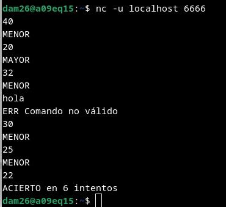
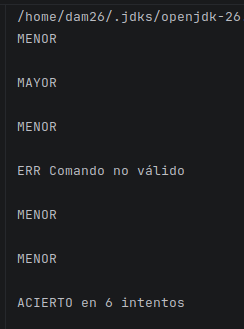
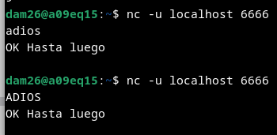

# Tarea28-PSP - Adrián Sande Domínguez

### Pruebas del funcionamiento

### NOTA -> Utilicé la opción -u en nc ya que mi código funciona bajo UDP, y necesita este argumento para realizar la interacción

### Puse capturas de pantalla del resultado desde la terminal de Intelliji

Al hacer Ctrl + C no sale ningún error, simplemente cierra la conexión

